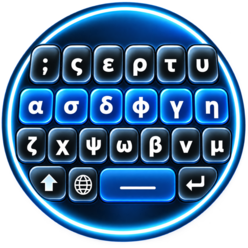
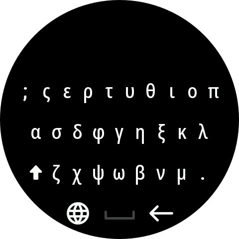
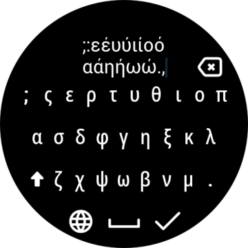
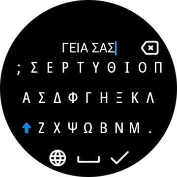
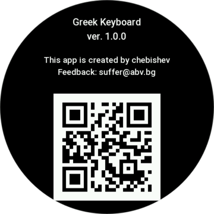

# Greek Keyboard

Greek keyboard with a traditional Greek QWERTY layout for Zepp OS.

Greek Keyboard provides a traditional Greek layout for compatible
Zepp OS devices.

## Features

- Greek keyboard with a traditional Greek QWERTY layout
- Lowercase and uppercase input
- Longpress ';' for ':'
- Longpress '.' for ','
- Longpress 'ε' for 'έ'
- Longpress 'υ' for 'ύ'
- Longpress 'ο' for 'ό'
- Longpress 'ι' for 'ί'
- Longpress 'η' for 'ή'
- Longpress 'α' for 'ά'
- Longpress 'ω' for 'ώ'
- Integration with the Zepp OS input method system
- English and Greek interface, depending on the watch language

## Compatibility

- Zepp OS API Level 4.2+
- Square and Round devices support

## Credits

Based on the official Zepp OS Simple Keyboard sample:
https://github.com/zepp-health/zeppos-samples/tree/main/application/4.2/simple-keyboard

## Screenshots

## License
Zepp OS samples are provided by Zepp Health under the Apache License 2.0.